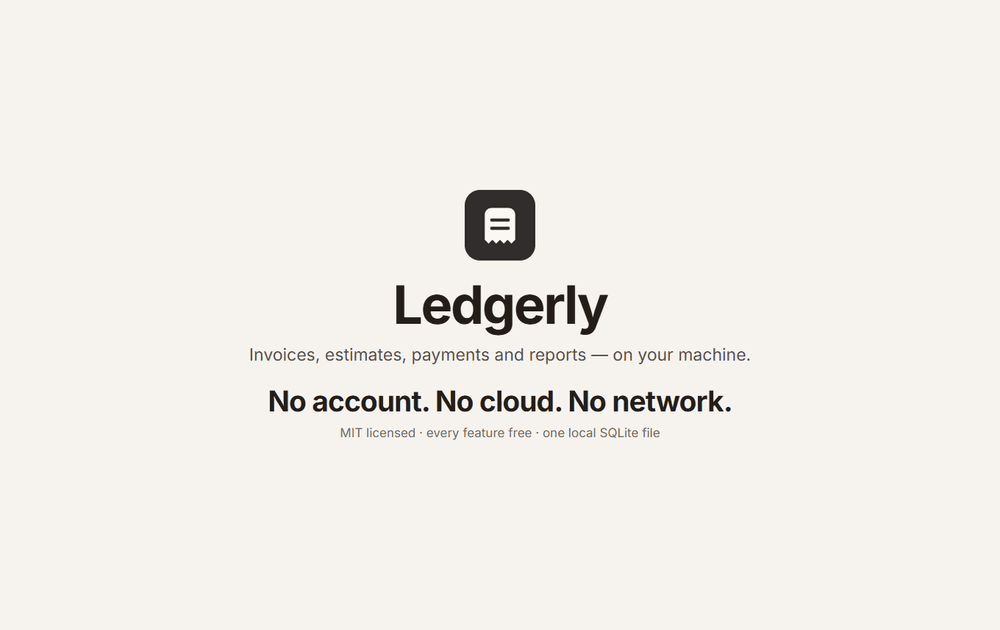

# Ledgerly

A fully local, fully offline desktop invoicing app for freelancers and small
businesses. Manage clients, create invoices and estimates, track payments, run
reports and export professional PDFs — with no account, no cloud and no network
dependency. Every feature is free.

Built with **Rust + Tauri 2**, a **Svelte 5 + TypeScript** frontend, and a local
**SQLite** file.

> The product name "Ledgerly" is a placeholder.



## What it does

- **Clients and a reusable catalog** of products and services, with a catalog
  picker right inside the invoice editor.
- **Invoices** with line items, per-line and invoice-level discounts, multiple
  tax rates, tax-inclusive or exclusive pricing, and a totals engine that
  reconciles to the cent.
- **Payments and lifecycle** — record full or partial payments; draft, sent,
  partially paid, paid, overdue and void are derived, not hand-set. Aged
  receivables on the dashboard.
- **Estimates** that convert into a linked invoice in one click, and export to
  PDF like invoices do.
- **PDF export** with three templates, an embedded font, pagination and a
  void watermark.
- **Reports** — revenue by period and client, aged receivables, tax collected
  per rate, payments by method — each exportable to CSV, plus a whole-database
  JSON export.
- **Backups** to a single portable `.ledgerly` file, with restore, a
  pre-restore safety copy, and rotating automatic backups.
- **App lock** with an Argon2id passphrase, enforced in the Rust core, with
  auto-lock on idle.
- **A command palette** (`Ctrl/Cmd+K`), keyboard shortcuts, and a mascot called
  Tally.
- **AI access over MCP** (optional): a companion `ledgerly-mcp` program lets a
  desktop AI assistant read your data and, if you allow it, change it — over
  standard input and output only, so the app still makes no network requests.
  See [`docs/AI.md`](docs/AI.md).

## Walkthrough

Recorded from the running app, one chapter per feature area — real clicks,
typing, dropdowns and dialogs, not mockups. Every chapter is below; a sharper
mp4 of each is in [`docs/preview/`](docs/preview/).

**1. Dashboard, chasing and the command palette** — outstanding and overdue, the
"Needs chasing" row actions, drill-downs from the charts, and `Ctrl/Cmd+K`.


**2. Finding an invoice** — search, status filter, clear filter, open a record.


**3. The invoice editor** — line items, the catalog picker, discounts, live totals.


**4. Payments, chasing and sending** — partial payment, copy reminder, delete +
Undo, the paid celebration, sent/draft.


**5. Creating an invoice from scratch** — pick a client, add from the catalog, save.


**6. Estimates that convert into an invoice** — status change and one-click convert.


**7. Clients and their history** — search, balances, invoices and estimates, edit.


**8. The catalog** — add an item, search, inline row editing.


**9. Reports and exports** — date range, all five reports, CSV and JSON export.


**10. Business profile and invoicing** — business details, tax rates, numbering.


**11. Backups and restore** — data location, back up now, automatic backups.


**12. AI access over MCP** — enable, allow changes, copy the client config.


**13. App lock, appearance, about and support** — the lock, motion, licence.


## The promise

**Ledgerly makes no network requests.** No telemetry, no analytics, no update
checks, no licence server, no account. `npm run check:offline` enforces it in CI
by failing the build if an HTTP client crate, a browser networking API, or a
remote URL appears anywhere in the dependency graph or source.

## Licence

**MIT.** See [LICENSE](LICENSE). Use it, change it, ship it, sell it. It comes
with no warranty.

There is no paid tier, no trial and no licence key: every feature is unlocked
for everyone. If it saves you time, there is a "support us" button in
`Settings → Support` — entirely optional, and it changes nothing inside the app.

## Layout

```
TASKS.json    Cross-session task and feature tracker
docs/         PRD and release checklist
src/          Svelte frontend
src-tauri/    Rust core (Tauri backend), migrations and assets
scripts/      CI helpers
```

## Develop

Prerequisites: Rust (stable, MSVC toolchain on Windows), Node 20+, and the
platform Tauri prerequisites (WebView2 on Windows, `libwebkit2gtk-4.1-dev` etc.
on Linux).

```bash
npm install
npm run tauri dev
```

## Build

```bash
npm run tauri build
```

## Test

```bash
cargo test --manifest-path src-tauri/Cargo.toml
npm run check          # svelte-check
npm run check:offline  # no network access
```

## Docs

- [`docs/PRD.md`](docs/PRD.md) — the product requirements and design.
- [`docs/RELEASING.md`](docs/RELEASING.md) — release checklist and signing.
- [`docs/AI.md`](docs/AI.md) — connecting a desktop AI assistant over MCP.
- [`docs/preview/`](docs/preview/) — the recorded feature walkthrough, chapter by chapter.
- [`docs/screenshots/`](docs/screenshots/) — interface captures at desktop, tablet and phone widths.
- [`TASKS.json`](TASKS.json) — cross-session task and feature tracker: flip
  `current` to the id in progress and move finished items to `done`.

## Status

Feature-complete against the PRD milestones M0–M10. Known gaps: the database is
**not encrypted at rest** (SQLCipher needs a vendored OpenSSL build), the app UI
is English-only with document labels localized, and recurring invoices are not
implemented. See `docs/RELEASING.md`.
