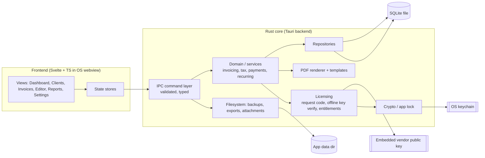
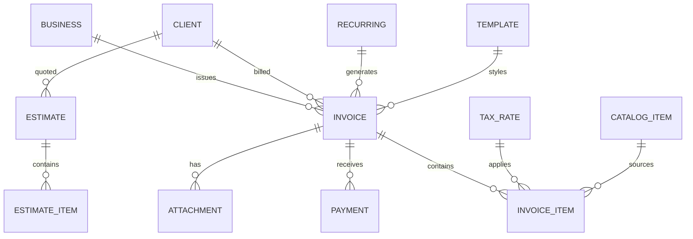

# PRD: Ledgerly — Offline Invoice Generator for Freelancers & Small Businesses

**Document status:** Draft v0.3
**Product type:** Native desktop application (Rust + Tauri)
**Platforms:** Windows 10/11, macOS 12+, Linux (AppImage / .deb)
**Owner:** _(fill in)_
**Last updated:** 2026-10-14

> **Freemium is superseded (2026-10-14).** The project is **MIT with every feature
> unlocked**; the licensing/freemium plan — the Pro tier, upgrade keys, activation,
> machine binding and entitlements — was dropped and its subsystem removed from the
> codebase. Passages in this document that still describe Free/Pro, request codes,
> upgrade keys or entitlement gating are the original plan, kept as a record; see
> §13 for the design and its reasoning. Everything else below still stands.

---

## 1. Summary

Ledgerly is a **fully local, fully offline** desktop invoicing application for freelancers and
small businesses. It lets a single user manage clients, create and send professional invoices
and estimates, record payments, track what is owed, and export clean PDFs — all without an
account, a subscription, a cloud service, or a network connection.

The product is built as a **Tauri 2.x** desktop app: a **Rust** core (data, business logic,
PDF generation, licensing, filesystem) with a lightweight web frontend rendered by the OS
webview. The guiding principle is **"your data never leaves your machine."** The app must
function identically with the network cable unplugged, forever — **including licensing, which
is verified entirely offline** via a machine-bound upgrade key (see §13). There is no account,
no online activation, no subscription enforcement over the network, and no phone-home.

Ledgerly is **freemium**: a complete, unlimited **Free** tier plus a one-time **Pro upgrade**
unlocked by an offline license key cryptographically bound to the machine (see §13). The app
generates its own unique installation serial on first run; the license request and the upgrade
key are exchanged **out of band by the user** (copy/paste or a `.lic` file), so the app itself
never needs a network connection to be licensed.

---

## 2. Why build this

Existing invoicing tools fall into two camps:

- **Cloud SaaS (FreshBooks, Wave, Zoho Invoice, Invoice Ninja Cloud):** require an account,
  a subscription, and constant connectivity; data lives on someone else's server.
- **Self-hosted / open-source (Invoice Ninja, Crater, InvoicePlane):** powerful but web-stack
  heavy, require running a PHP/Node server and a database, and are awkward as a single-user
  desktop tool.

There is a clear gap for a **single-binary desktop app that a freelancer installs once and
uses offline**, with data stored in a plain local file they own, no server to run, and modern
PDF output. Rust + Tauri is an unusually good fit: small binaries, low memory, native
performance, and the ability to do PDF generation, SQLite, and crypto entirely in-process
with no runtime dependencies.

**Core differentiators**

1. **Truly offline** — zero network calls in normal operation; no telemetry, no update phone-home.
2. **Data you own** — one portable SQLite file + attachments folder; transparent backup/restore.
3. **No runtime** — no Node/Python/PHP/Java install; ships as a signed OS-native installer (~10–20 MB).
4. **Fast and boring** — cold start under 1.5s, PDF export under a second, works on a 10-year-old laptop.
5. **Professional output** — branded, tax-aware invoices that look good enough to send to enterprise clients.
6. **Honest freemium** — a free tier you can use indefinitely plus a one-time Pro upgrade, verified **offline** against a machine-bound key so it needs no account and no internet (see §13).

---

## 3. Goals & Non-Goals

### 3.1 Goals

- Create, edit, duplicate, and export **professional invoices** and **estimates/quotes** in minutes.
- Manage **clients** and a reusable **catalog of products/services**.
- Handle real-world money: **line items, quantity, unit price, per-line and invoice-level discounts, multiple tax rates (inclusive/exclusive), multi-currency**.
- Track invoice lifecycle: **draft → sent → partially paid → paid → overdue / void**.
- Record **partial and full payments** and show outstanding balances.
- Export **PDF**, print, and export structured **CSV/JSON** for accountants.
- Provide a **dashboard and basic reports** (revenue, outstanding/aged receivables, tax summary).
- **Local backup and restore**, and optional **at-rest encryption / app lock**.
- Ship as a **signed, double-click installer** for Windows, macOS, and Linux.
- Offer a **credible free tier** that a freelancer can use indefinitely, and a **Pro upgrade**
  unlocked offline, so the product is sustainable without ever holding user data on a server.

### 3.2 Non-Goals (explicitly out of scope for v1)

- **No cloud sync, no accounts, no login servers.** Not now, likely never.
- **No sending email from the app.** Invoices are exported to PDF and the user sends them via their own mail client. (We generate a share-ready file and can copy a mailto/subject line.)
- **No online payment collection** (Stripe/PayPal integrations).
- **No bank feeds / open banking / automatic reconciliation.**
- **No double-entry accounting.** This is invoicing, not a general ledger. (A simple ledger *view* for income is acceptable; full accrual accounting is not.)
- **No multi-user / team collaboration / permissions** in v1.
- **No mobile app** (Tauri mobile may be revisited in v2).
- **No automatic tax filing** or jurisdiction-specific compliance engines; we provide rates and reports, not tax advice.
- **No auto-update over the network.** Updates are manual downloads (see §12.6).
- **No account, no activation, no license server.** The app is MIT and free — there is nothing
  to activate and no backend of ours to contact. The original freemium plan is kept in §13.
- **No hardware dongle, no cloud seat enforcement, no account-based DRM.** Moot: there is no
  key and no paid tier.
- **No anti-tamper arms race.** The binary is not obfuscated and we do not try to defeat a
  determined user who patches it.

---

## 4. Target Users & Personas

| Persona | Context | Key needs |
|---|---|---|
| **"Lena" — Freelance designer** | Solo, 5–20 invoices/month, works from a MacBook and a Windows desktop, often offline while travelling. | Fast invoice creation, her logo/colors on the PDF, know who hasn't paid, export to client. |
| **"Marco" — Small contractor** | 3-person crew, invoices weekly, needs quotes → invoice, deposits/partial payments, per-job line items. | Estimates that convert to invoices, partial payments, job totals, simple tax. |
| **"Priya" — Consultant/agency of one** | Cross-border clients, invoices in USD/EUR/GBP, needs clean reporting for her accountant. | Multi-currency, multi-language PDF labels, CSV export, tax summary report. |
| **"Sam" — Privacy-conscious professional** | Refuses SaaS for client data; wants to hand over the raw data file if they stop using the tool. | Local-only storage, open, portable data format, no telemetry, backup. |

**Primary persona:** Lena (single user, low volume, wants speed and a professional look, values privacy and offline operation).

---

## 5. User Stories

**Clients**
- As a user, I can add a client with name, email, phone, billing address, tax/VAT ID, currency, and notes, so I can reuse it on invoices.
- As a user, I can search/filter clients and see their invoice history and outstanding balance.

**Catalog**
- As a user, I can save reusable products/services (description, default price, default tax) so I don't retype line items.

**Invoices**
- As a user, I can create an invoice, pick a client, set issue/due dates, and add line items with qty/price/discount/tax.
- As a user, I can apply an invoice-level discount (fixed or %) and see tax computed correctly on the discounted subtotal.
- As a user, I can add notes, terms, PO numbers, and a payment-instructions block.
- As a user, I can **duplicate** an invoice, **void** one, and **auto-number** invoices with a configurable scheme/prefix.
- As a user, I can save a draft and come back to it.

**Estimates**
- As a user, I can create an estimate/quote and later **convert it into an invoice** in one click.
- As a user, I can set an estimate as accepted/declined/expired.

**Payments & status**
- As a user, I can record a full or partial payment with date, amount, method, and note.
- As a user, I can see the outstanding balance and status (draft/sent/partial/paid/overdue/void) at a glance.
- As a user, I can mark an invoice sent and record the date (used for aging).

**Output**
- As a user, I can export a single invoice to PDF, print it, or export a batch to PDF.
- As a user, I can export invoices/payments/clients to CSV and the whole database to JSON.

**Branding & templates**
- As a user, I can upload a logo, set brand colors, and choose between PDF templates.
- As a user, I can set default terms/notes and payment instructions once and have them applied.

**Reports**
- As a user, I can see a dashboard: this month's revenue, outstanding amount, overdue amount, recent activity.
- As a user, I can run reports: revenue by period/client, aged receivables (30/60/90+), tax collected by period, payments received.

**Recurring**
- As a user, I can define a recurring invoice (weekly/monthly/quarterly/custom) that the app generates automatically when due.

**Data safety**
- As a user, I can back up everything to a single file and restore it on another machine.
- As a user, I can optionally lock the app with a passphrase and encrypt the database at rest.

---

## 6. Functional Requirements

Requirements are prioritized **P0 (must-have for v1)**, **P1 (should-have)**, **P2 (nice-to-have / post-v1)**.

### 6.1 Business Profile & Settings — P0

| ID | Requirement |
|---|---|
| FR-SET-1 | Configure business identity: legal name, display name, logo, address, email, phone, website, tax/VAT/GST ID, registration number. |
| FR-SET-2 | Set default currency, currency symbol placement, decimal separator, thousands separator, and date format. |
| FR-SET-3 | Set default payment terms (e.g. Net 30 → auto due date), default tax rate, default notes/terms, and default payment instructions. |
| FR-SET-4 | Configure invoice numbering scheme: prefix, suffix, zero-padding, next number, reset annually (e.g. `INV-2026-0042`). |
| FR-SET-5 | Choose default PDF template and accent color; upload a logo (PNG or JPEG, up to 2 MB, kept in the database next to the business profile). |
| FR-SET-6 | Set app language (UI + PDF labels) and per-document language for PDF labels. |
| FR-SET-7 | Configure data directory location and backups. |

### 6.2 Client Management — P0

| ID | Requirement |
|---|---|
| FR-CLI-1 | CRUD clients: display name, company, contact person, email, phone(s), billing address (structured), shipping address (optional), tax ID, currency override, language override, tags, notes. |
| FR-CLI-2 | Search by name/email/company/tag; sort and filter (e.g. has outstanding balance). |
| FR-CLI-3 | Client detail view: contact info, invoice history, outstanding/paid totals, notes. |
| FR-CLI-4 | Archive (soft-delete) clients that have invoices; hard-delete only if unreferenced. |
| FR-CLI-5 | Import clients from CSV — P1. |

### 6.3 Product/Service Catalog — P1

| ID | Requirement |
|---|---|
| FR-CAT-1 | CRUD catalog items: name, description, default unit (hour/day/item/word), default unit price, default tax rate, SKU (optional). |
| FR-CAT-2 | Insert a catalog item into an invoice with one click; still editable per line. |

### 6.4 Invoice Creation & Editing — P0

| ID | Requirement |
|---|---|
| FR-INV-1 | Create invoice: auto-assigned number, client, issue date, due date (derived from terms or manual), currency, PO/reference, template. |
| FR-INV-2 | Line items: description, quantity (decimal), unit, unit price, per-line discount (% or fixed), tax rate(s), computed line total. Reorderable, with an optional section/group heading. |
| FR-INV-3 | Invoice-level discount (% or fixed), applied before tax per configured rule. |
| FR-INV-4 | Tax handling: multiple named tax rates; support **tax-exclusive** and **tax-inclusive** pricing; support compound tax (P2); per-line tax overrides. |
| FR-INV-5 | Rounding: configurable line-level vs invoice-level rounding; totals must reconcile exactly (no off-by-a-cent). |
| FR-INV-6 | Notes, terms & conditions, and payment instructions blocks (rich-ish text: line breaks, bold, bullet lists). |
| FR-INV-7 | Attachments per invoice (e.g. timesheet, receipt) stored locally and optionally bundled when exporting a ZIP (P1). |
| FR-INV-8 | Duplicate an invoice; save as draft; auto-save while editing. |
| FR-INV-9 | Void an invoice (keeps number, excludes from totals) and a separate "mark as cancelled". |
| FR-INV-10 | Live totals panel: subtotal, discount, tax breakdown by rate, total, amount paid, balance due. |
| FR-INV-11 | Multi-currency: each invoice has a currency and a locked exchange rate (manual, offline); reports can show a chosen base currency using stored rates (P1). |

### 6.5 Invoice Lifecycle & Payments — P0

| ID | Requirement |
|---|---|
| FR-LIF-1 | Statuses: **Draft, Sent, Partially Paid, Paid, Overdue, Void**. `Overdue` is derived from due date + balance, not manually set. |
| FR-LIF-2 | "Mark as sent" records a sent date/timestamp for aging (manual action; no email). |
| FR-LIF-3 | Record payments: date, amount, method (cash/bank/transfer/card/other), reference, note. Over-payment is rejected or held as credit (configurable) — P1. |
| FR-LIF-4 | Payment list per invoice; delete/edit payment recalculates status. |
| FR-LIF-5 | Dashboard counts/sums by status; aging buckets 0–30 / 31–60 / 61–90 / 90+ days. |

### 6.6 Estimates / Quotes — P1

| ID | Requirement |
|---|---|
| FR-EST-1 | Same editor as invoices with its own numbering (`EST-` prefix), validity/expiry date, and statuses (Draft, Sent, Accepted, Declined, Expired, Converted). |
| FR-EST-2 | Convert an estimate to an invoice, copying line items and client, linking both records. |
| FR-EST-3 | Show "expiring soon / expired" indicators. |

### 6.7 Recurring Invoices — P2 (P1 if time permits)

| ID | Requirement |
|---|---|
| FR-REC-1 | Define a recurring template with interval (weekly/biweekly/monthly/quarterly/yearly or custom N days), start date, end date/occurrence count, and auto-issue (draft vs sent). |
| FR-REC-2 | On app launch, generate any invoices whose scheduled date has passed; never generate duplicates; record the run in a log. |
| FR-REC-3 | Surface a **local notification** for due/overdue invoices (OS notification, no network). Now its own deliverable, `NOTIFY` (which needs the tray, `TRAY`); see `ROADMAP.md`. |

### 6.8 PDF Generation & Templates — P0

| ID | Requirement |
|---|---|
| FR-PDF-1 | Generate a print-quality PDF (A4/Letter, configurable) for an invoice/estimate. |
| FR-PDF-2 | Include: logo, business & client blocks, invoice meta (number, dates, PO, currency), line-item table, tax/discount breakdown, totals, amount due, notes/terms/payment instructions, and a page footer with page numbers. |
| FR-PDF-3 | Ship **at least three templates**: *Classic* (formal, serif, bordered), *Modern* (sans, accent color block), *Minimal* (lots of whitespace). |
| FR-PDF-4 | **Embed fonts** in the PDF so output is identical on every machine and printer, with full Unicode (accents, €, £, ₹) support. |
| FR-PDF-5 | Support **multi-page** invoices with a repeating table header and page numbering. |
| FR-PDF-6 | "Save PDF as…" file dialog with a sensible default filename (`INV-2026-0042_ClientName.pdf`); batch export selected invoices to a folder or ZIP (P1). |
| FR-PDF-7 | Print directly via the OS print dialog (P1) and open the generated PDF in the system viewer. |
| FR-PDF-8 | Mark paid/void states visibly (e.g. "PAID" watermark) — configurable. |

### 6.9 Reports & Dashboard — P1

| ID | Requirement |
|---|---|
| FR-REP-1 | Dashboard: revenue this month vs last, total outstanding, total overdue, recent invoices/payments. |
| FR-REP-2 | Revenue by period (day/week/month/year) and by client. |
| FR-REP-3 | Aged receivables report. |
| FR-REP-4 | Tax collected by rate and period (for filing). |
| FR-REP-5 | Payments received by period/method. |
| FR-REP-6 | Export any report to CSV/PDF. |

### 6.10 Data Portability, Backup & Restore — P0

| ID | Requirement |
|---|---|
| FR-DAT-1 | Export all data to a single portable backup file (`.ledgerly` = ZIP containing SQLite DB + attachments + a manifest with schema version). |
| FR-DAT-2 | Restore/import a backup file (with confirmation and an automatic pre-restore safety copy). |
| FR-DAT-3 | Scheduled local backups (e.g. on app close, keep last N, rotating) to a user-chosen folder (default: app data dir). |
| FR-DAT-4 | Export invoices/clients/payments to CSV; export the whole DB to JSON for external tooling. |
| FR-DAT-5 | Show a "where is my data" screen with the actual file path and a button to open it in the OS file manager. |

### 6.11 Security & Privacy — P1

| ID | Requirement |
|---|---|
| FR-SEC-1 | **No network access** in normal operation. Ship with a strict Content-Security-Policy and no external resource loading in the webview. |
| FR-SEC-2 | Optional **app lock**: passphrase (Argon2id-derived key) unlocking at launch and after idle timeout. |
| FR-SEC-3 | Optional **at-rest encryption** of the database (SQLCipher) and of the key stored in the OS keychain (Windows Credential Manager / macOS Keychain / libsecret). |
| FR-SEC-4 | Auto-lock on idle and on minimize-to-tray, configurable. The tray is `TRAY`; until it exists, only the idle lock applies. |
| FR-SEC-5 | Explicit "no telemetry" statement; document exactly what is stored and where. |

### 6.12 Localization & Accessibility — P1

| ID | Requirement |
|---|---|
| FR-L10N-1 | UI localizable; ship English initially, with a structure that allows community translation. |
| FR-L10N-2 | PDF labels localizable independently of the UI (invoice in the client's language). |
| FR-A11Y-1 | Full keyboard navigation, focus management, visible focus rings, screen-reader labels, and no color-only status indicators. |
| FR-A11Y-2 | Respect OS light/dark theme; sufficient contrast. |

### 6.13 Licensing & Offline Activation — P0 *(superseded — see §13)*

| ID | Requirement |
|---|---|
| FR-LIC-1 | On first run the app generates a **unique installation serial** (128-bit random, UUIDv7-class), stored encrypted in the app data dir and recorded in the DB. It never changes for the life of the installation. |
| FR-LIC-2 | The app computes a **machine fingerprint** from several stable, locally-read identifiers (see §13.2), hashed with SHA-256. The raw identifiers are never stored or transmitted — only the hash. |
| FR-LIC-3 | The app produces a human-copyable **License Request Code** that binds installation serial + machine fingerprint + product/SKU + version. Displayable as grouped text, copy-to-clipboard, save-to-file, and QR code. |
| FR-LIC-4 | The user can import an **Upgrade Key** (paste text or load a `.lic` file). The app verifies it **locally and offline** (signature + binding + expiry) and, on success, unlocks Pro. |
| FR-LIC-5 | The app shows license status: Free / Pro, SKU, plan kind (perpetual / subscription-term / version-locked), expiry if any, the bound machine fingerprint (short form), and activation date. |
| FR-LIC-6 | Importing an invalid, mismatched, expired, or tampered key fails with a clear, actionable message; nothing about the key is trusted before signature verification. |
| FR-LIC-7 | If the machine fingerprint changes (hardware swap, OS reinstall), the app detects the mismatch and offers a guided **re-activation** flow that produces a new request code for a re-issued key. |
| FR-LIC-8 | Optional **time-limited trial** of Pro features (default 14 days), enabled locally, with the start date stored encrypted. Expiry is enforced locally. |
| FR-LIC-9 | The app can **deactivate locally** (forget the license on this machine) — this does not contact any server. |
| FR-LIC-10 | Feature gating is centralized: a single `entitlements` service answers "is feature X allowed?" so Free/Pro behavior is consistent and testable everywhere. |
| FR-LIC-11 | License data is preserved across backup/restore; restoring a backup on different hardware keeps Free status until re-activated. |
| FR-LIC-12 | No network call is made at any point in the licensing flow (request, import, verify, re-activate). |

---

### 6.14 AI Access (MCP) — P1

| ID | Requirement |
|---|---|
| FR-AI-1 | The app ships a companion `ledgerly-mcp` program that exposes its data and actions to a desktop AI assistant over the **Model Context Protocol**, using **stdio only** — no socket, no port and no network call, so the §7 offline guarantee is unchanged. |
| FR-AI-2 | AI access is **off by default** and switched on by the user in **Settings → AI**. |
| FR-AI-3 | Reads (clients, catalog, tax rates, invoices, estimates, payments, business profile, settings, reports) are available once access is on. |
| FR-AI-4 | Writes (create/update/duplicate/mark sent or chased, record payments, convert estimates, take a backup) require a second, independent **Allow changes** switch. |
| FR-AI-5 | When the app lock is on, the assistant must supply the passphrase from its client config; without a verifying passphrase every request is refused. |
| FR-AI-6 | Destructive and identity-changing actions — restore a backup, void an invoice, delete a payment, change the app lock, open files, export the database — are **never** exposed to the assistant. |
| FR-AI-7 | The assistant and the app share one SQLite database and may run at the same time. |

---

## 7. Non-Functional Requirements

| Category | Requirement |
|---|---|
| **Offline** | The app performs **zero outbound network requests** during normal use. No telemetry, no analytics, no crash reporting to a server, no update checks. This must be verifiable (e.g. a test that asserts no sockets are opened; no HTTP client crate compiled in). |
| **Offline licensing** | License verification is **local-only** (public-key signature + machine binding). Request-code generation, key import, verification, trial and re-activation all work with the network disabled. The only network involved anywhere is the user's own out-of-band channel to the vendor when buying/re-issuing a key. |
| **License robustness** | Upgrades must not invalidate an existing key; license format is versioned with a key id to allow vendor key rotation. Verification must be deterministic and covered by tests for valid/tampered/mismatched/expired keys. |
| **Data ownership** | All data lives in a single SQLite database plus an attachments folder inside the OS app-data directory (path shown to the user). Files are standard and readable without the app. |
| **Performance** | Cold start < 1.5s on a mid-range machine; invoice list of 10,000 rows scrolls smoothly (virtualized); PDF export < 1s for a 1-page invoice; SQLite queries indexed and < 20ms typical. |
| **Reliability** | Writes are transactional; no data loss on power failure. Autosave drafts. Crash-safe (no partial DB writes). |
| **Binary size** | Installer ≈ 8–20 MB (platform dependent); no bundled browser/runtime. |
| **Memory** | Idle < 120 MB RAM. |
| **Cross-platform** | Windows 10/11 (x64, arm64), macOS 12+ (universal: Intel + Apple Silicon), Linux (x64 AppImage + .deb). Identical features on all three. |
| **Security** | CSP locked down; IPC surface minimal and validated in Rust; path traversal prevented on all file operations; no `shell` execution. |
| **Accessibility** | WCAG 2.1 AA for the app UI to the extent a desktop webview allows. |
| **Portability of install** | Uninstall must not silently delete user data; data directory is preserved unless the user explicitly removes it. |
| **Licensing** | App code is **MIT** (see `LICENSE`); bundled fonts under OFL with attribution. |

---

## 8. Technical Architecture

### 8.1 Stack

| Layer | Choice | Rationale |
|---|---|---|
| Shell / runtime | **Tauri 2.x** | Native window + OS webview, small binary, Rust backend, no bundled Chromium. |
| Backend | **Rust** (stable, edition 2021) | Data layer, business logic, PDF, crypto, files. |
| Frontend | **Svelte 5 + TypeScript + Vite**, static build (`adapter-static`) | Small bundle, no server runtime, excellent fit for offline SPA. *(React + Vite is an acceptable alternative; Svelte preferred for size.)* |
| Styling | **Tailwind CSS** + a small design system | Fast, consistent UI; theme support. |
| State | Svelte stores (or TanStack Query keyed to IPC) | Simple, no heavy dependency. |
| DB | **SQLite** via `rusqlite` (`bundled` feature) | Embedded, single-file, no external runtime; `bundled` compiles SQLite in, so no system dependency. |
| Migrations | Embedded SQL migrations (`refinery` or a hand-rolled `user_version` migrator) | Deterministic, versioned schema. |
| Money math | `rust_decimal` + integer minor units | Exact decimal math, no float errors. |
| PDF | Pure-Rust (`printpdf`, or a small HTML→PDF path if fidelity allows) | Fully offline, no browser engine required. Fonts embedded. |
| Crypto | `argon2`, `aes-gcm`/SQLCipher, `keyring` crate | App lock + at-rest encryption + OS keychain. |
| Licensing | `ed25519-dalek` (verify), `sha2`, `base32` (Crockford), `machine-uid` + platform identifiers | Offline upgrade-key verification, request-code generation, machine binding. Vendor-side signing uses a separate signing tool (§13.5). |
| Dates/time | `chrono` / `time` | Timezone-aware due dates, no network time. |
| IDs | UUIDv7 | Sortable, offline-generated, no coordination. |
| Serialization | `serde` + `serde_json` | IPC payloads, JSON export. |
| Errors | `thiserror` (+ `anyhow` internally) | Typed errors mapped to IPC responses. |

> **Decision — PDF strategy:** generate PDFs **in Rust** rather than rendering HTML in the webview and printing. Rationale: identical output across platforms, no dependence on webview print fidelity, full control over pagination and font embedding, and fully offline. If a template proves too layout-heavy, a *fallback* is to render a print-optimized HTML page in a hidden Tauri window and invoke the platform print-to-PDF — but that is a fallback, not the default.

### 8.2 High-level architecture



### 8.3 IPC surface (indicative commands)

```
business_get_profile / business_update_profile
settings_get / settings_set
clients_list / clients_get / clients_create / clients_update / clients_archive / clients_import_csv
catalog_list / catalog_upsert / catalog_delete
invoices_list / invoices_get / invoices_create / invoices_update / invoices_duplicate
invoices_void / invoices_mark_sent / invoices_next_number
invoice_items_reorder
payments_list_for_invoice / payments_create / payments_update / payments_delete
estimates_* (mirror of invoices) / estimates_convert_to_invoice
recurring_list / recurring_upsert / recurring_run_due
reports_dashboard / reports_revenue / reports_aged_receivables / reports_tax / reports_export_csv
pdf_render_invoice (returns bytes) / pdf_export_invoice_to (writes via dialog) / pdf_batch_export
backup_create / backup_restore / backup_list / data_open_location
security_lock / security_unlock / security_set_passphrase / security_status
license_status / license_request_code / license_save_request_file / license_import_key
license_import_file / license_deactivate / license_trial_start / license_entitlements
```

Every command: typed input/output, validated in Rust, returns a `Result` mapped to a structured error object the UI can display. No filesystem path is taken from the UI without normalization + containment checks.

### 8.4 Project layout

```
ledgerly/
  src/                     # Svelte frontend
    routes/ components/ lib/ stores/ styles/
  src-tauri/
    src/
      main.rs              # app bootstrap, plugin registration
      commands/            # #[tauri::command] handlers
      domain/              # invoicing, tax, payments, recurring, numbering
      db/                  # connection pool, repositories, migrations/
      pdf/                 # renderer + templates
      licensing/           # installation serial, machine fingerprint, request codes,
                           # upgrade-key verification, entitlements (feature gates)
      crypto/              # app lock, sqlcipher wiring, key the installation serial is sealed with
      fs/                  # backups, exports, paths
      error.rs
    migrations/
    tauri.conf.json
    capabilities/          # Tauri 2 permissions
  Cargo.toml
  package.json
```

### 8.5 On-disk format

```
%APPDATA%/Ledgerly/            (Windows)   ~/Library/Application Support/Ledgerly/  (macOS)   ~/.local/share/ledgerly/ (Linux)
  data/ledgerly.db             # SQLite (optionally encrypted)
  data/attachments/<invoice-id>/...
  backups/ledgerly-YYYYMMDD-HHMMSS.ledgerly
  logs/app.log                 # local only, capped, rotated
```

---

## 9. Data Model (SQLite)



Indicative tables (abridged):

| Table | Key columns |
|---|---|
| `business` | id, legal_name, display_name, email, phone, website, address_json, tax_id, reg_no, default_currency, default_tax_rate_id, default_template_id, accent_color, default_terms, default_notes, default_payment_instructions, numbering_json, pdf_locale, created_at, updated_at |
| `business_logo` | id ('default'), bytes (BLOB), mime — the image is kept in the database, not on disk, so a backup carries it and no filesystem scope is needed |
| `client` | id, display_name, company, contact_person, email, phone, address_json, shipping_address_json, tax_id, currency, locale, tags_json, notes, archived_at, created_at, updated_at |
| `catalog_item` | id, name, description, unit, unit_price_minor, currency, tax_rate_id, sku, archived_at |
| `invoice` | id, number, client_id, status, issue_date, due_date, sent_at, currency, exchange_rate, po_reference, template_id, discount_type, discount_value, subtotal_minor, discount_minor, tax_minor, total_minor, paid_minor, balance_minor, notes, terms, payment_instructions, locale, estimate_id, recurring_id, voided_at, created_at, updated_at |
| `invoice_item` | id, invoice_id, sort_order, section, description, quantity, unit, unit_price_minor, discount_type, discount_value, tax_rate_id, tax_inclusive, line_subtotal_minor, line_discount_minor, line_tax_minor, line_total_minor |
| `estimate` / `estimate_item` | mirror of invoice tables with `valid_until`, `converted_invoice_id` |
| `payment` | id, invoice_id, date, amount_minor, currency, method, reference, note, created_at |
| `tax_rate` | id, name, rate_bp (basis points), compound, archived_at |
| `tax_rate_rule` | optional: mapping for inclusive/exclusive + rounding |
| `template` | id, name, kind (classic/modern/minimal), config_json, is_builtin |
| `recurring` | id, name, template_invoice_json, interval, interval_count, start_date, end_date, occurrences, next_run_date, auto_issue, active, last_run_at |
| `attachment` | id, invoice_id, filename, stored_path, mime, size, created_at |
| `installation` | app_serial (PK, uuid), machine_fp_hash, product_sku, first_seen_at, os, first_app_version, last_app_version |
| `license` | id, key_id, sku, plan_kind (perpetual / term / version_locked), features_json, issued_at, expires_at, binding_hash, key_blob, activated_at, status (active / invalid / expired / revoked), last_verified_at |
| `trial` | started_at, ends_at, consumed |
| `setting` | key, value_json |
| `schema_migration` | version, applied_at |
| `audit_log` | id, entity, entity_id, action, diff_json, at (P2) |

**Money representation:** all monetary values stored as **integer minor units** (e.g. cents) with an explicit currency; intermediate math via `rust_decimal`. Never store floats.

---

## 10. Key UX Flows

### 10.1 First run
1. Welcome → "Create your business profile" (name, logo, address, currency, default terms) → optional "Set an app lock" → done.
2. Empty dashboard with a primary CTA: **New invoice**.

### 10.2 Create & send an invoice
1. **New invoice** → pick/create client (inline) → issue date defaults to today, due date auto from terms.
2. Add line items: type or pick from catalog; qty/price/discount/tax; totals update live.
3. Optional discount, notes, terms, payment instructions.
4. **Export PDF** (Save-as dialog) → PDF opens in system viewer → user emails it themselves.
5. Back on the invoice, click **Mark as sent** → status `Sent`.

### 10.3 Get paid
1. Invoice detail shows **Balance due**.
2. **Record payment** (amount defaults to balance; method; date) → status becomes `Partially Paid` or `Paid`.
3. Dashboard "Outstanding" and "Overdue" update.

### 10.4 Quote → job → invoice
1. **New estimate** → same editor → export PDF, mark sent.
2. Client accepts → **Convert to invoice** → line items copied, linked, estimate marked `Converted`.

### 10.5 Backup / restore
1. Settings → **Backup now** → choose folder → `.ledgerly` file written.
2. New machine → **Restore from backup** → confirmation → current data safety-copied → restored → lists refresh.

### 10.6 Upgrade to Pro (offline, no network)
1. In **Free**, the user hits a Pro feature (e.g. custom PDF branding) → **Upgrade** dialog opens.
2. The dialog shows the **License Request Code** with **Copy**, **Save to file**, and a **QR code**, plus a link/instructions for where to send it (vendor's page/email — opened in the user's browser *only if they click it*; the app makes no request itself).
3. User sends the code out of band (email/purchase page) and receives an **Upgrade Key** (text or `.lic` file).
4. User pastes the key or loads the file → **Activate**.
5. Verified locally → dialog shows **Pro active**, plan and expiry → gated features unlock immediately. No restart required.
6. If verification fails (wrong machine, tampered, expired), a clear message explains why and offers **Re-issue** (generate a fresh request code) or **Support** (show diagnostics to copy).

### 10.7 Machine changed / re-activate
1. On launch, if the stored license's binding no longer matches the current machine fingerprint, the app keeps Free mode and shows a **License needs re-activation** notice.
2. User requests a re-issue with the new request code (out of band) and pastes the new key. All data is untouched.

---

## 11. Accessibility, Performance & Quality Bars

- **Keyboard-first:** `Ctrl/Cmd+N` new invoice, `Ctrl/Cmd+S` save, `Ctrl/Cmd+P` export PDF, `/` to search, arrow-key navigation in tables, `Esc` closes modals.
- **Virtualized** lists for 10k+ invoices/clients. **Declined after measuring.** At
  10,000 invoices the query returns the whole set in ~43 ms, so paging in SQL buys
  nothing; the cost is the DOM. The list pages now render a 250-row prefix and
  state the real total in words. Reproduce with
  `cargo test --manifest-path src-tauri/Cargo.toml -- --ignored --nocapture shows_how_the_list_scales`.
- **No blocking the UI thread:** PDF generation and backups run off the main thread; progress for long operations.
- **Deterministic totals:** a test suite asserts that subtotal − discount + tax = total to the cent across rounding modes and mixed tax-inclusive/exclusive lines.
- **Golden-file PDF tests:** render fixture invoices and compare extracted text/structure to guard against regressions.

---

## 12. Privacy & Security Model

### 12.1 Threat model
Primary concern is **unintended data exposure and loss**, not a remote attacker. The app runs locally with the user's privileges.

### 12.2 Network
- **No HTTP/TLS client crate is a dependency.** This is enforced in review and by a CI check.
- Webview CSP: `default-src 'self'; connect-src 'none'; img-src 'self' data:; style-src 'self' 'unsafe-inline'`. Tauri capabilities grant only the minimum plugins needed (dialog, fs-scoped, notification, os); `notification` is planned with `NOTIFY`, not yet shipped.
- No external fonts, no CDN, no remote images.

### 12.3 At rest
- Default: plain SQLite in the user data dir (relying on OS/disk encryption, which we document).
- Optional: SQLCipher with a key derived (Argon2id) from a user passphrase, key cached in the OS keychain; auto-lock on idle.
- Backups: optional passphrase encryption of the `.ledgerly` archive.

### 12.4 Input safety
- Rich-text fields are sanitized (no raw HTML injection into PDF or UI).
- All file paths normalized and confined to allowed directories; filenames sanitized for the OS.

### 12.5 Transparency
- A "Privacy" settings page states: no account, no telemetry, no network calls, exact data path, how to export/delete everything, and that the licensing machine fingerprint is a **local hash** whose raw underlying identifiers are never stored on disk or transmitted (§13.2).

### 12.6 Updates
- **Manual.** The app never checks for updates. Releases are published as signed installers + checksums; the app's About page links to the download page but does not fetch it automatically.

---

## 13. Licensing & Freemium Model (Offline Activation)

> **Superseded.** This section describes the original freemium plan. The project
> is now **MIT licensed with every feature unlocked**, and the offline activation
> subsystem (Ed25519 keys, request codes, `licensectl`, entitlement gating) has
> been removed from the codebase. It is kept here as a record of the design and
> its reasoning, not as a description of the current product. See §13.3 for the
> cryptographic argument, which is still the correct analysis of the original
> brief.

Ledgerly ships as a **freemium** product. The Free tier is genuinely usable forever; Pro is a
paid upgrade unlocked by an **offline license key cryptographically bound to the machine**.
Nothing about licensing requires the app to touch the network — the request and the key are
exchanged by the user, out of band.

> **Design note.** The brief describes the upgrade key as *"solving a cryptography problem"*
> derived from the app + machine serials. We implement that idea with the correct primitive — an
> **asymmetric digital signature** — rather than a home-made puzzle. See §13.3 for why.

### 13.1 Tier split

| Capability | Free | Pro |
|---|---|---|
| Clients, invoices, estimates — **unlimited** | ✅ | ✅ |
| Line items, discounts, multiple tax rates, rounding | ✅ | ✅ |
| PDF export | ✅ (1 template, small "Made with Ledgerly" footer) | ✅ (all templates, footer removable) |
| Payments & status tracking, dashboard | ✅ | ✅ |
| CSV / JSON export, manual backup & restore | ✅ | ✅ |
| App lock + at-rest encryption *(decided: security is not paywalled)* | ✅ | ✅ |
| **Custom branding** (logo, colors, footer, custom templates) | ❌ | ✅ |
| **Multi-currency** + exchange rates | ❌ | ✅ |
| **Recurring invoices** | ❌ | ✅ |
| **Reports** (revenue, aged receivables, tax summary, payments) + report PDF | ❌ | ✅ |
| **Batch** PDF export, invoice attachments | ❌ | ✅ |
| Scheduled / automatic rotating backups | ❌ | ✅ |
| Priority new features | ❌ | ✅ |

*(**Decided:** the Free/Pro boundary above is locked. Only the price and the one-time-vs-term model remain open — see §17.)*

### 13.2 Identifiers & machine binding

Two identifiers, combined into one binding hash:

- **Installation serial (the "unique encrypted serial generated at install").** A 128-bit
  random value generated on first run. It is sealed at rest with AES-GCM under a per-install
  key held in the **OS keychain**, and recorded in the DB. It is stable for the life of the
  installation and is what makes each install unique even on identical hardware.
- **Machine fingerprint.** Derived from a *small set* of stable OS-provided identifiers,
  normalized and hashed with SHA-256 so **the raw identifiers are never stored or transmitted**:

  | OS | Primary source(s) |
  |---|---|
  | Windows | `HKLM\SOFTWARE\Microsoft\Cryptography\MachineGuid` (fallback: system volume serial + CPU signature) |
  | macOS | `IOPlatformUUID` (fallback: hardware model + serial) |
  | Linux | `/etc/machine-id` (fallback: `/sys/class/dmi/id/product_uuid`) |

- **Binding** = `SHA-256(installation_serial ‖ machine_fingerprint ‖ sku)`. The UI shows only a
  short, grouped form (e.g. `4F2A-9C1B-77E0`) as a "machine ID" for support.

Using the installation serial *and* the fingerprint means a copied data folder alone does not
move Pro to another machine, and a hardware change alone does not either (both must match).

### 13.3 The upgrade key: a signature, not a puzzle

**The correct construction** is an **Ed25519 digital signature** over a small, canonical license
payload. The vendor holds a private key that **never ships with the app**; the app embeds only
the corresponding **public key**. The upgrade key is a signed entitlement that the app verifies
locally.

License payload (signed; canonical CBOR or JSON):

```
{
  "v": 1,
  "key_id": "ledgerly-2026",           // enables key rotation
  "sku": "pro",
  "plan": "perpetual" | "term" | "version_locked",
  "features": ["branding","multi_currency","recurring","reports","batch_export"],
  "issued_at": 1760000000,
  "expires_at": null,                   // null = perpetual
  "seats": 1,
  "binding": "sha256(app_serial ‖ machine_fp ‖ sku)"
}
```

- **Upgrade Key** = `Base32( CBOR{ payload, sig } )`, delivered as pasteable grouped text
  (Crockford Base32, blocks of 5 with a check symbol) **and** as a `.lic` file (loadable, and
  scannable via QR for extra convenience). The signature is 64 bytes, so a *file/QR* is the
  **decided primary UX**; typed/pasted text is supported as a secondary path.
- **Verification (all local):** decode → check `key_id` is a known/embedded public key →
  `Ed25519_verify(payload, sig, public_key)` → check `binding` equals the locally recomputed
  binding → check `expires_at` (with a small clock-skew allowance) → grant entitlements.

**Why not a "hash puzzle" / home-made challenge:**
- A *verifiable* key must be unforgeable. That is exactly what a signature provides, using a
  private key the attacker does not have — while the app needs only a public key to check.
- A puzzle whose solution is computed from the serials either (a) embeds the solving algorithm
  in the binary, so it is invertible and anyone can mint keys for any machine, or (b) if made
  genuinely hard (proof-of-work style), it becomes slow/impractical and still does not bind
  meaningfully to a specific machine.
- Signatures also let us **rotate** and **re-issue** keys, and they make "flip a flag in the DB"
  impossible: the app re-verifies the signature at each launch.

### 13.4 License Request Code

The app builds a request payload — `{ v, sku, app_serial, machine_fp, app_version, os }` — and
encodes it as grouped Base32 text, a saved file, and a QR code. It contains **no PII**: an
random install serial and a salted device hash. The vendor needs these values to compute the
`binding` that the signed key will commit to.

### 13.5 Vendor-side issuance (separate, offline tooling)

- A private CLI, `ledgerly-licensectl` (never distributed with the app), run by the vendor:
  input = request code → output = upgrade key. The signing key lives on an air-gapped machine
  or HSM and is backed up securely.
- Supports: issue for a given sku/plan/expiry, **re-issue** (e.g. after a hardware change),
  bulk generation, and a **revocation list** that can be embedded into a *future app release*
  (note the limitation: an already-released, offline app cannot be told about a revocation).
- **Key rotation:** `key_id` in the payload; the app embeds the current and previous public keys.

### 13.6 Local storage & integrity

- The verified license (payload + signature) is stored in the DB and re-verified on every
  launch; entitlements are derived from the verified license, never from a mutable boolean.
- The installation serial and the trial start are sealed (AES-GCM, key in the OS keychain).
- Trial/term expiry uses best-effort clock-tamper detection: store the highest time ever seen
  and reject a system clock that has moved backwards past a threshold.

### 13.7 Threat model & honest limitations

| Attack | Mitigation | Residual risk |
|---|---|---|
| Forge a key without the vendor private key | Ed25519 signature verification | None practical |
| Share one key across many machines | Machine binding (`binding` mismatch → reject) | VM clones sharing machine-id (mitigate with 2–3 fingerprint signals) |
| Edit the DB to flip Pro on | Signature re-verified each launch; entitlements recomputed | — |
| Patch the binary to skip the check | Accepted; we do not obfuscate | A determined user can crack any local app |
| Roll the clock back to keep a trial/term license | Best-effort monotonic "max time seen" check | Partially mitigable only |

**Stance:** cryptography protects the vendor's business relationship and stops casual key
sharing and forgery. We explicitly **do not** enter an obfuscation/anti-debug arms race; the
right defense is a fair price and a good free tier.

### 13.8 Plans

- **Perpetual** — one-time, machine-bound, includes updates for a stated window (or version-locked; confirm).
- **Term / subscription** — `expires_at` set; expiry enforced **locally** (the app never calls home).
- **Version-locked vs all-future-versions** — a `plan` flag decides whether newer app versions honor the key.
- **Seats:** v1 = one machine per key. Multi-seat (v2) = a seat count plus a list of device bindings, still fully offline.

### 13.9 Feature gating

A single `entitlements` service in the Rust core answers `is_allowed(feature)` for the whole
app. The UI reads entitlements to show lock badges and upgrade CTAs; the core enforces them on
the corresponding IPC commands so gating cannot be bypassed from the frontend. On any license
verification problem the app **degrades to Free and never hides or deletes user data**.

---

## 14. Release Plan / Milestones

| Milestone | Scope | Exit criteria |
|---|---|---|
| **M0 — Skeleton** | Tauri 2 + Svelte scaffold; SQLite bundled; migrations; app data dir; settings store; CI (fmt/clippy/test/build) for 3 OSes. | App launches offline on all 3 OSes; schema v1 migrates. |
| **M1 — Identity & Clients** | Business profile, logo upload, clients CRUD + search, catalog CRUD. | Can create a client and a catalog item and see them persisted. |
| **M2 — Invoices** | Invoice editor, line items, taxes, discounts, rounding, numbering, live totals, autosave, duplicate/void. | Totals correctness test suite green; create/edit/duplicate works. |
| **M3 — PDF** | Rust PDF renderer, 3 templates, font embedding, multipage, Save-as, open in viewer. | Golden-file PDF tests green on all OSes; Unicode renders. |
| **M4 — Payments & Dashboard** | Payments CRUD, statuses, aging, dashboard. | Record partial payment updates status + dashboard. |
| **M5 — Estimates** | Estimate editor, statuses, convert-to-invoice. | Quote converts with linked records. |
| **M6 — Reports & Export** | Revenue/aged/tax reports, CSV/JSON export, batch PDF. | Reports reconcile with raw data; exports open in Excel. |
| **M7 — Data Safety** | Backup/restore, scheduled backups, data-location screen. | Restore on a clean machine reproduces all data. |
| **M8 — Licensing & Freemium** | Installation serial + at-rest sealing, machine fingerprint, request code (text/file/QR), Ed25519 key verification, entitlements gating, Free/Pro split, optional trial, re-activation, and the vendor-side `ledgerly-licensectl`. *(Dropped — the app is free/MIT; see `TASKS.json` M8.)* | Free tier fully usable; a vendor-issued key unlocks Pro **with the network disabled**; forged/tampered/mismatched/expired keys are rejected (unit tests). |
| **M9 — Security & i18n** | App lock, optional SQLCipher, notifications, UI/PDF localization. *(SQLCipher and notifications split out — `SEC-ENCRYPT` deferred, `NOTIFY` its own item.)* | Lock/unlock verified; EN complete. |
| **M10 — Polish & Release** | Recurring invoices, a11y pass, perf pass, packaging/signing/notarization, docs. *(Purchase/issuance runbook dropped with licensing.)* | Signed installers for Win/macOS/Linux; no-network CI check green. |

*(Ordering is intentional: data safety and shipping a usable invoice→PDF path early; security and i18n after the core is stable.)*

---

## 15. Success Metrics

**Product**
- Time from first launch to first exported invoice PDF **< 5 minutes** (median, first-run test).
- A returning user can create and export a routine invoice **< 90 seconds**.
- **Zero** outbound network calls in normal operation (CI assertion).
- Crash-free session rate **> 99.5%** (measured locally via opt-in crash log the user can inspect, never auto-sent).

**Business / licensing — retired with §13.** The freemium model was dropped; the app is
MIT with every feature unlocked, so conversion, activation and re-activation metrics no
longer apply. The one assertion worth keeping is already under Product: zero network calls
in normal operation.

**Technical**
- Cold start **< 1.5s**; PDF export **< 1s** (1 page).
- Installer **< 20 MB** per platform.
- Money-math test suite: **100%** pass across rounding/tax permutations.
- Golden PDF tests pass on Windows, macOS, Linux.

**Adoption (soft)**
- User can complete a full month of invoicing without ever needing a network connection.

---

## 16. Risks & Mitigations

The rows marked **(retired)** below belonged to the freemium model dropped in §13; they
are kept as a record and no longer carry live mitigations.

| Risk | Impact | Mitigation |
|---|---|---|
| PDF layout fidelity across platforms | Inconsistent invoices | Generate in Rust with embedded fonts; golden-file tests per OS; keep templates layout-simple. |
| Font licensing / Unicode gaps | Missing glyphs, legal issues | Bundle OFL fonts (e.g. Inter, Source Serif) with attribution; test €/£/₹/accents/CJK fallback. |
| Data loss (user deletes folder / disk failure) | Catastrophic for a business | Scheduled rotated backups, clear data-location UI, export/restore, document OS backup. |
| Scope creep toward full accounting | Slipped v1 | Non-goals enforced; ledger is a view, not double-entry. |
| SQLite encryption complexity (SQLCipher + bundling) | Build pain on 3 OSes | Make encryption opt-in and isolate behind a feature/abstraction; ship v1 unencrypted-capable first. |
| Recurring invoices generated twice | Duplicate billing | Idempotent run keyed on `(recurring_id, scheduled_date)`; append-only run log. |
| Timezone edge cases on due dates | Wrong overdue status | Store dates as local calendar dates, computed with a fixed app timezone/date-only semantics. |
| Webview differences across OSes | UI bugs | Test on all three OSes in CI + manual smoke; avoid exotic CSS. |
| **(retired)** License key sharing / piracy | Lost revenue | Machine binding so a key only works on the machine it was issued for; signatures prevent forgery. Accept that a patched binary can bypass checks (§13.7). |
| **(retired)** Brittle machine fingerprint (hardware change or VM clone breaks or duplicates binding) | Locked-out paying users / shared keys | Use 2–3 stable signals; clear re-activation flow; monitor re-activation support rate; allow a manual override policy. |
| **(retired)** Vendor signing key compromise | Attackers can mint keys for any machine | Keep the private key air-gapped/HSM, back it up offline, plan rotation via `key_id`, embed current + previous public keys. |
| **(retired)** Clock manipulation for term/trial licenses | Free Pro via rollback | Best-effort monotonic "highest time seen" check; accept residual risk. |
| **(retired)** Offline revocation impossible | Can't disable a leaked key after release | Revocation list can only be honored by *future* releases; keep key issuance tight and bound to one machine. |
| **(retired)** Entitlement split feels unfair | Backlash / churn | Keep the free tier genuinely usable; do not paywall security (app lock/encryption) — confirm in §17. |

---

## 17. Open Questions

**Closed by the freemium decision (see §13):** the tier split, upgrade-key delivery,
fingerprint policy, seats and pricing model are all moot — the app is MIT with every
feature unlocked.

**Resolved since this draft:**

- **App licence** — **MIT** (see `LICENSE`).
- **Frontend framework** — **Svelte 5**, as shipped.

**Still open:**

1. **Encryption default** — deferred with `SEC-ENCRYPT`; opt-in if it is ever built.
2. **Recurring invoices in v1** or defer to a point release? (Currently P2 — tracked as `RECURRING`.)
3. **Base-currency reporting** — manual exchange rates only for v1, or a rate-table import?
4. **Payments ledger model** — simple "payments against invoices" (chosen) vs a general income ledger (needed for expenses?). Confirm non-goal.
5. **Templates** — ship 3 built-in; do we allow user-authored templates (HTML/Handlebars) in v1 or v2?
6. **Naming** — "Ledgerly" is a placeholder.

---

## 18. Appendix

### 18.1 Glossary
- **Estimate/Quote** — a priced proposal that can become an invoice.
- **Aged receivables** — outstanding balances grouped by how long they've been due.
- **Tax-inclusive pricing** — the line price already contains tax (common in some regions).
- **Minor units** — the smallest currency unit (e.g. cents) used to store money exactly.
- **`.ledgerly`** — the portable backup archive (ZIP: `db.sqlite`, `attachments/`, `manifest.json`).
- **Installation serial** — the unique random id generated on first run, sealed at rest; makes each install unique.
- **Machine fingerprint** — a SHA-256 hash of stable OS/hardware identifiers; never stores or sends the raw values.
- **Binding** — `SHA-256(installation_serial ‖ machine_fingerprint ‖ sku)`; the value a license commits to.
- **License Request Code** — grouped Base32 text the user sends to the vendor to obtain a key.
- **Upgrade Key / `.lic`** — the vendor-signed license (payload + Ed25519 signature) that unlocks Pro.
- **Entitlements** — the set of Pro features granted by a verified license; queried by `is_allowed(feature)`.

### 18.2 Indicative Rust dependencies
`tauri`, `serde`, `serde_json`, `rusqlite` (features: `bundled`, `chrono`, `uuid`), `refinery` (or custom), `uuid` (v7), `chrono`, `rust_decimal`, `printpdf` (or `genpdf`), `argon2`, `aes-gcm`/`sqlcipher`, `keyring`, **`ed25519-dalek`**, **`sha2`**, **`base32`** (Crockford), **`machine-uid`** (+ `winreg` on Windows), **`qrcode`**, **`ciborium`** (canonical CBOR for the license payload), `thiserror`, `anyhow`, `tracing` + `tracing-appender` (local logs), `zip`, `csv`, `rfd` (or Tauri dialog plugin), `tauri-plugin-notification`, `tauri-plugin-os`.

*(Vendor-side `ledgerly-licensectl` reuses `ed25519-dalek` for **signing** and is not shipped in the app.)*

### 18.3 Actual frontend dependencies

Shipped: `svelte` 5, `@sveltejs/kit` (SPA mode, `adapter-static`), `vite`, `typescript`,
`svelte-check`, and `@tauri-apps/api` with the `dialog` and `opener` plugins. That is the whole
list, and only the three Tauri packages reach the running app.

Deliberately **not** used, against the earlier indicative list:

- **`tailwindcss`** — styling is a hand-authored token layer in `src/app.css` (468 lines, 51 custom
  properties) plus component-scoped styles. Nothing in the app references Tailwind.
- **`date-fns`** — `src/lib/format.ts` is small, local-date aware, and already tested against the
  Rust side's conventions.
- **A virtual-list library** — declined after measuring; see §11.
- **A chart library** — the two dashboard charts are hand-rolled CSS.

Reversed since this list was written: **`plugin-notification`** was declined on
the grounds that "the app never pushes anything at the user". Decided 2026-10-14:
that holds for everything except overdue invoices, notified locally, on by default
(`NOTIFY`). The plugin is added when `NOTIFY` ships — and only then.

### 18.4 Reference formats
- Currency formatting: use CLDR-style rules (symbol placement, grouping) implemented locally, not fetched.
- Dates: ISO-8601 internally; locale-formatted for display/PDF.

---

*End of PRD v0.1*
