# Ledgerly previews

Two kinds of preview, both here so a specific capability is easy to find
without watching everything.

- **The teaser** — the short animated overview the README embeds:
  [`../screenshots/preview.gif`](../screenshots/preview.gif). A brand-led tour
  built in HyperFrames (`tools/preview/`); `npm run gif` there rebuilds it.
- **The walkthrough** — this folder. Real screen recordings of the running app,
  one chapter per feature area, driving the actual UI (clicks, typing, dropdowns,
  dialogs, scrolling). Not a slideshow.

Every chapter is available as both a **gif** (to embed in a README) and an
**mp4** (smaller, sharper, for the docs). The walkthrough is recorded by
`tools/preview-record/` (see its README); every chapter starts from the same
deterministic demo data, so re-running produces the same tour.

## Chapters

| # | Chapter | Length | gif | mp4 | What it shows |
|---|---|---|---|---|---|
| 01 | Dashboard, chasing and the command palette | 22s | 1.7 MB | 1.3 MB | Outstanding/overdue hero, "Needs chasing" with Copy-reminder and Mark-chased, aged-receivables and billed-and-collected drill-downs, `Ctrl/Cmd+K` command palette, `Ctrl/Cmd+N` |
| 02 | Finding an invoice | 12s | 0.5 MB | 0.5 MB | List search, status filter, clear filter, open a record |
| 03 | The invoice editor | 9s | 0.6 MB | 0.4 MB | Line items, catalog picker, per-line and invoice discounts, live totals |
| 04 | Payments, chasing and sending | 29s | 1.2 MB | 0.8 MB | Record a partial payment, copy the reminder, delete + Undo, a settling payment and the paid celebration, save, sent/draft toggle |
| 05 | Creating an invoice from scratch | 15s | 0.8 MB | 0.5 MB | New invoice, pick a client, add lines from the catalog, totals, save |
| 06 | Estimates and convert-to-invoice | 9s | 0.5 MB | 0.4 MB | Estimate detail, status change, one-click convert to a linked invoice |
| 07 | Clients and their history | 16s | 0.6 MB | 0.5 MB | Client search, show-archived, balances, invoices and estimates, edit and save |
| 08 | The catalog | 19s | 0.9 MB | 0.6 MB | Add an item, search, inline row editing |
| 09 | Reports and exports | 13s | 0.7 MB | 0.5 MB | Date range and granularity, all five reports, per-report CSV, JSON export |
| 10 | Business profile and invoicing | 17s | 0.9 MB | 0.6 MB | Business details, tax rates, invoice numbering with live preview |
| 11 | Backups and restore | 10s | 0.5 MB | 0.3 MB | Data location, back up now, automatic-backup settings, restore |
| 12 | AI access over MCP | 10s | 0.6 MB | 0.5 MB | Enable AI access, allow changes, copy the server path and client config, the read/change/never summary |
| 13 | App lock, appearance, about and support | 18s | 0.8 MB | 0.6 MB | Enable the app lock, motion level, version/paths, licence and support |

`manifest.json` carries the machine-readable index (subjects, lengths, sizes,
trim offsets).

> The main [`README.md`](../../README.md) embeds all thirteen. They total about
> 10 MB; drop any you do not need to keep the page light.

## Gallery

### 01 — Dashboard, chasing and the command palette
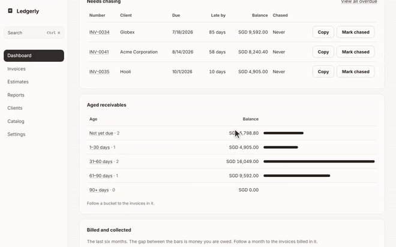

### 02 — Finding an invoice
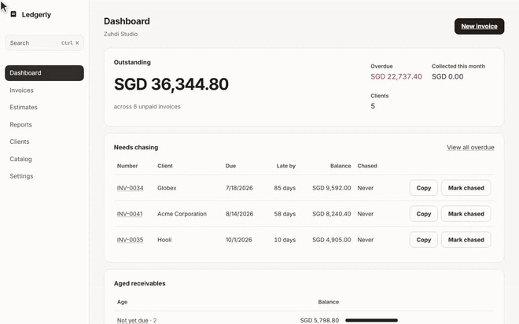

### 03 — The invoice editor
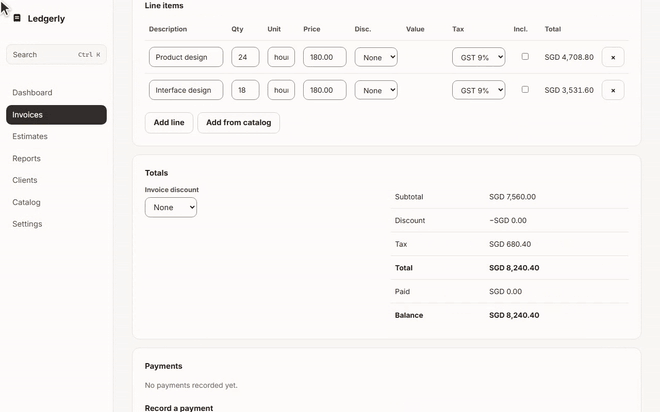

### 04 — Payments, chasing and sending
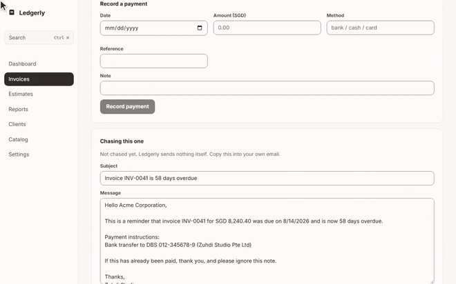

### 05 — Creating an invoice from scratch
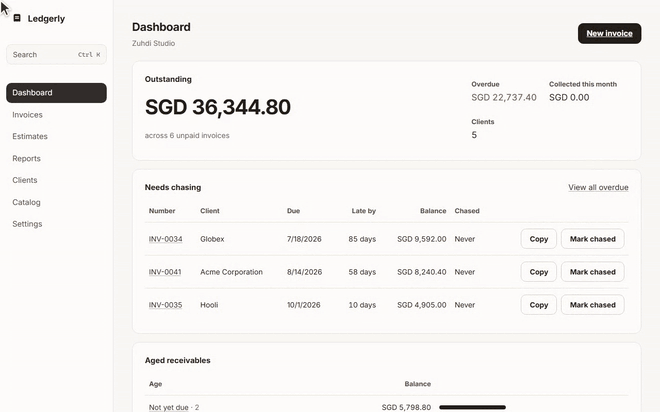

### 06 — Estimates and convert-to-invoice
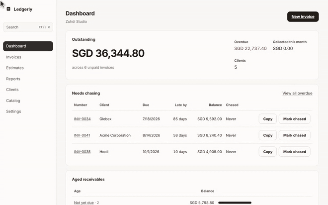

### 07 — Clients and their history
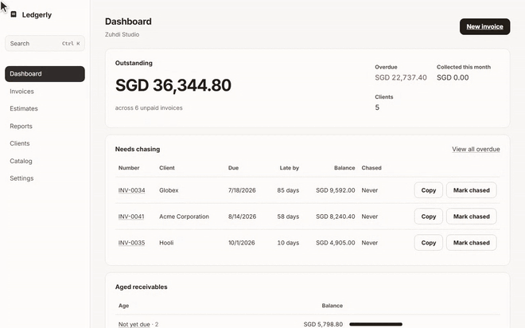

### 08 — The catalog
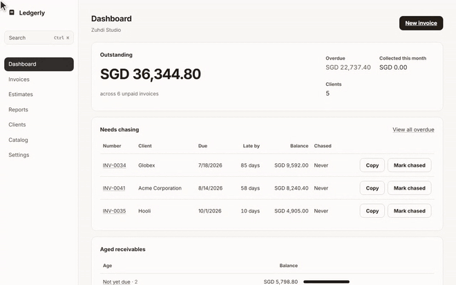

### 09 — Reports and exports
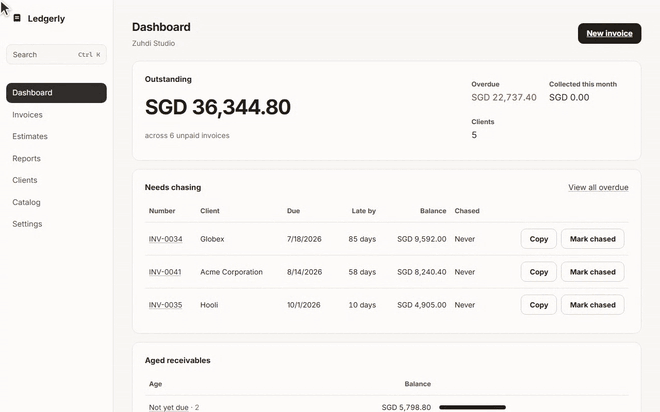

### 10 — Business profile and invoicing
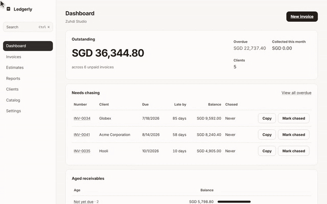

### 11 — Backups and restore
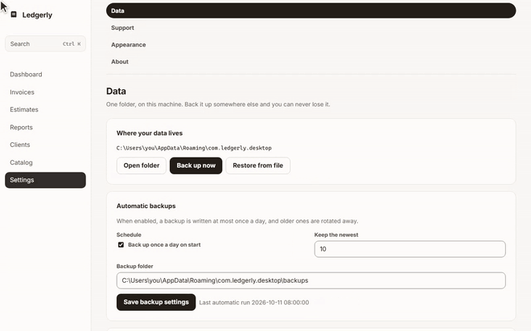

### 12 — AI access over MCP
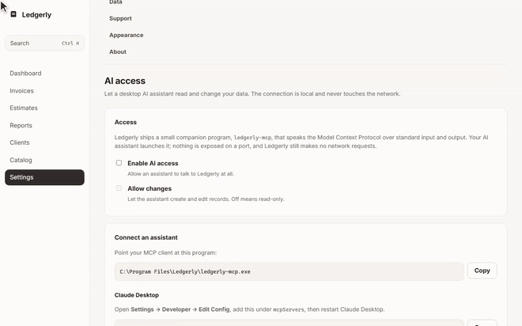

### 13 — App lock, appearance, about and support
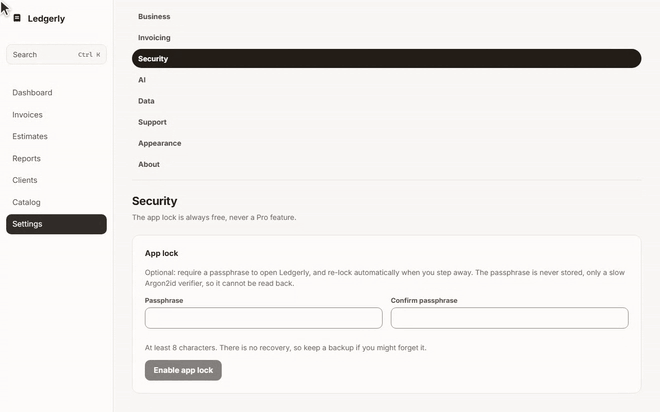

## Regenerate

```sh
# 1. record (starts the dev server, drives the UI, writes out/*.webm + manifest)
python tools/preview-record/record.py

# 2. encode every chapter to gif + mp4 into docs/preview/
python tools/preview-record/encode.py
#    --mp4-only  /  --gif-only   to produce one format

# the branded teaser gif, separately
cd tools/preview && npm run gif
```

Needs Python 3 with Playwright (`pip install playwright && playwright install
chromium`) and `ffmpeg` on PATH. `record.py --list` lists segments;
`--only 04-payments` records one.

## What these previews cannot show

Recorded against the frontend with a stubbed IPC, so two things are out of reach
and are documented rather than faked in `../preview-feature-audit.md`:

- **File-writing paths** — PDF/statement export, a real `.ledgerly` backup and
  the OS save/open dialogs and viewer need the packaged desktop app.
- **MCP tool calls** — the `ledgerly-mcp` server is a separate stdio process an
  external assistant launches; the app only configures access (chapter 12).

Feature-by-feature coverage — including what is *not* covered — is in
[`../preview-feature-audit.md`](../preview-feature-audit.md).
